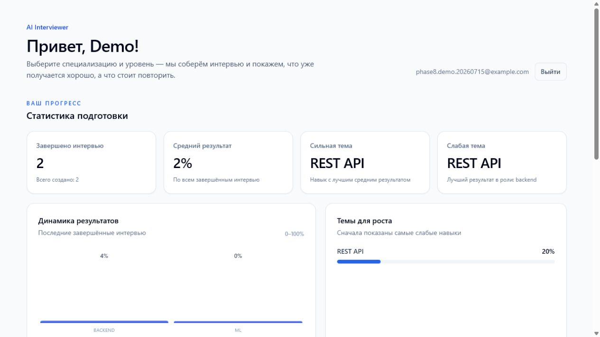
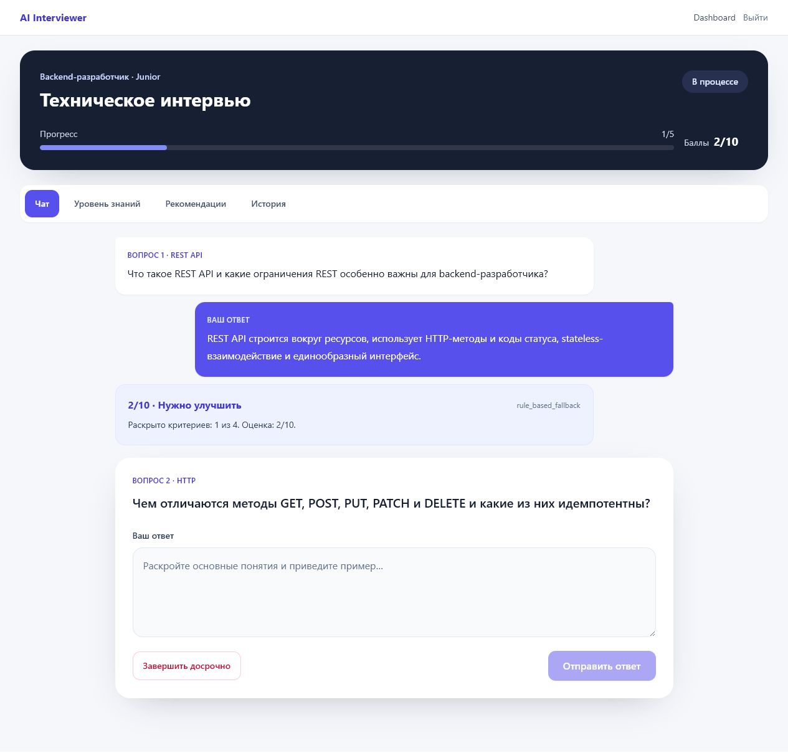
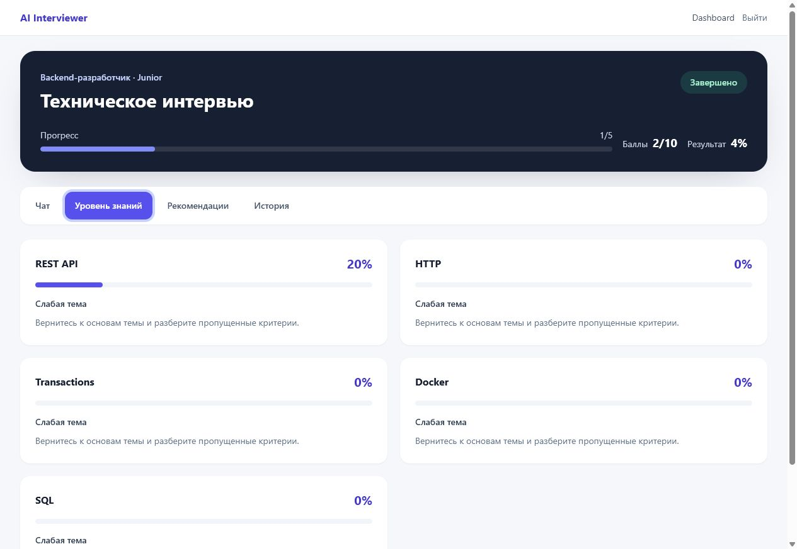
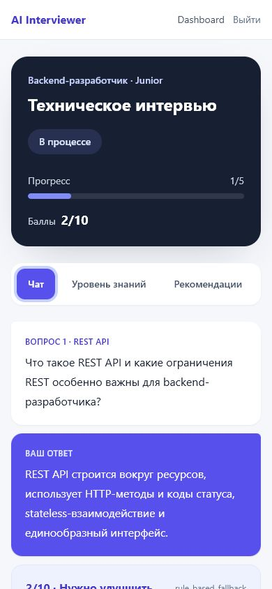

# AI Interviewer

AI Interviewer is a full-stack training platform for technical interviews. A user selects a role and level, answers questions in a chat interface, and receives scoring, skill analysis, and learning recommendations.

The project is being implemented incrementally according to [PRD.md](./PRD.md) and [plan.md](./plan.md). The current application includes JWT authentication, an LLM-generated adaptive interview state machine, local LLM integration with deterministic scoring fallback, a persistent topic knowledge graph, baseline ML analytics, recommendations, and the complete frontend workflow.

## Architecture

```text
Browser
  |
  v
Next.js frontend
  |
  v
FastAPI api-service ---- PostgreSQL (interviews, topic graph, LLM metadata)
  |        |
  |        +------------ Redis (provisioned; no speculative MVP cache)
  |
  +---- FastAPI llm-service ---- Ollama / Qwen3.5 9B
  |          evaluation failure -> rule scoring
  |
  +---- FastAPI ml-service
             knowledge update + recommendation ranking
             failure -> deterministic knowledge/recommendation fallback
```

The browser talks only to API-service. API-service owns authentication and business flow;
PostgreSQL is the source of truth. LLM-service validates structured API output, while ML-service
updates the weighted knowledge graph and loads versioned recommendation/analytics artifacts.
Both inference paths have controlled fallbacks, so they do not compromise the interview flow.

Compose readiness follows required dependencies: frontend waits for API; API waits for PostgreSQL,
Redis and LLM-service. Ollama inference and ML-service are not hard startup dependencies because
the interview has deterministic scoring, knowledge-selection and saved-question fallbacks.

## Current stack

- Next.js, React, TypeScript, Tailwind CSS
- FastAPI, Pydantic, async SQLAlchemy, Alembic, pytest
- PostgreSQL 16
- Redis 7
- Local Qwen3.5 9B through Ollama's OpenAI-compatible Chat Completions API
- scikit-learn baseline models (TF-IDF/logistic regression and random forest)
- Docker Compose

## Prerequisites

- Docker Desktop with Docker Compose v2
- Git

Node.js 22.13+ with Corepack/pnpm and Python 3.12+ are only required when
running services outside Docker.

## Start with Docker Compose

1. Create a local environment file:

   ```powershell
   Copy-Item .env.example .env
   ```

2. Replace `JWT_SECRET_KEY` in `.env` with a long random value.

3. Build and start the services:

   ```text
   docker compose up --build
   ```

   The API container applies pending Alembic migrations before starting Uvicorn.

   To apply migrations manually:

   ```text
   docker compose exec api-service alembic upgrade head
   ```

4. Download Qwen3.5 9B once after the stack starts:

   ```text
   docker compose exec ollama ollama pull qwen3.5:9b
   ```

   The model is stored in the `ollama_data` volume and reused on later starts.

5. Verify the running applications:

   - Frontend: http://localhost:3000
   - API health: http://localhost:8000/health
   - LLM-service health: http://localhost:8001/health
   - Local LLM health: http://localhost:8001/llm/health
   - ML-service health: http://localhost:8002/health

Stop the stack without deleting its volumes:

```text
docker compose down
```

## Local development

API service:

```text
cd services/api-service
python -m venv .venv
.venv\Scripts\Activate.ps1
python -m pip install -r requirements-dev.txt
Copy-Item .env.example .env
alembic upgrade head
uvicorn app.main:app --reload --port 8000
```

Available API endpoints at this stage:

- `GET /health`
- `POST /api/v1/auth/register`
- `POST /api/v1/auth/login`
- `GET /api/v1/users/me` (Bearer token required)
- `GET /api/v1/roles`
- `POST /api/v1/interviews`
- `GET /api/v1/interviews`
- `GET /api/v1/interviews/{id}`
- `POST /api/v1/interviews/{id}/answers`
- `POST /api/v1/interviews/{id}/finish`
- `GET /api/v1/interviews/{id}/result`
- `GET /api/v1/analytics/summary`
- `GET /api/v1/analytics/skills`
- `GET /api/v1/analytics/progress`

LLM-service endpoints:

- `GET /health`
- `GET /llm/health`
- `POST /llm/interviewer-message`
- `POST /llm/evaluate-answer`

Quality analytics use finished interviews. Interview averages are calculated from
per-interview percentages; skill percentages use total earned points divided by
total maximum points. Skills below 70% are reported as weak skills.

Frontend:

```text
cd frontend
corepack enable
pnpm install
pnpm run dev
```

LLM service:

```text
cd services/llm-service
python -m venv .venv
.venv\Scripts\Activate.ps1
python -m pip install -r requirements-dev.txt
uvicorn app.main:app --reload --port 8001
```

ML service:

```text
cd services/ml-service
python -m venv .venv
.venv\Scripts\Activate.ps1
python -m pip install -r requirements-dev.txt
python -m training.generate_synthetic --output data/synthetic
python -m training.train --data data/synthetic --output artifacts
$env:ML_ARTIFACT_DIR = "$PWD\artifacts"
uvicorn app.main:app --reload --port 8002
```

ML-service endpoints:

- `GET /health`
- `POST /ml/predict-level`
- `POST /ml/classify-weak-topic`
- `POST /ml/recommendations/rank`

Training uses a deterministic synthetic dataset (`seed=42`). Generated `metrics.json` includes
accuracy, macro F1, classification reports and confusion matrices; `manifest.json` fixes model
version, data schema version, labels and numeric feature order. Synthetic metrics validate the
pipeline and must not be treated as expected production quality.

To export schema `1.0` anonymized features from completed interviews without user identifiers,
UUIDs, timestamps or free-text answers:

```text
docker compose exec api-service python -m app.scripts.export_ml_training_data /tmp/ml-export
```

The selected interview level is exported as a proxy label, not as an independent expert
assessment. API-service uses ML only to rank already generated recommendations; if ML is disabled,
unavailable or returns an invalid order, the deterministic rule-based order is preserved.

## Example user flow

1. Register at `/register` and sign in at `/login`.
2. On `/dashboard`, select a role and level and start an interview.
3. Answer 15 generated questions in the chat. Each response receives a score, verdict and feedback.
4. After the fifteenth answer, open the knowledge, recommendations and answer-history tabs.
5. Return to the dashboard to see the updated statistics and completed interview.

## Screenshots

### Dashboard analytics



### Interview and feedback



### Knowledge results



### Mobile interview



## Adaptive interview, knowledge graph, and LLM fallback

Every interview contains 15 LLM-generated questions. Qwen creates the first five together across
five different fundamental areas and excludes the user's previous questions. These answers form
the initial knowledge map. For questions 6–15, ML-service selects the weakest or least certain
subtopic and Qwen generates the next question specifically for that target. For every answer,
`llm-service` returns topic weights and coverage. API-service calculates the score from
`weight × coverage`, persists per-topic score/confidence/evidence, asks ML-service for the next
weak or uncertain subtopic, and saves an LLM-generated question before returning it to the browser.

API-service talks only to `llm-service`; the external key never reaches frontend or the database.
If evaluation fails, the rule score is used. If ML fails, the same weighted baseline runs in
API-service. Question generation has no prepared fallback: the API returns a controlled `503`
instead of assigning a saved question. Only provider/model/latency/success metadata is persisted;
prompts, model responses and API keys are not logged.

## Recommendations

`RecommendationService` aggregates completed answers by skill. Scores below 40% produce high-priority recommendations, scores from 40% through 69% produce medium-priority recommendations, and skills at 70% or above need no recommendation. Suggested topics come from the evaluation criteria missing in the candidate's answers.

## Quality checks

API:

```text
cd services/api-service
pytest
ruff check .
ruff format --check .
```

Frontend:

```text
cd frontend
pnpm run lint
pnpm run typecheck
pnpm run build
```

LLM service:

```text
cd services/llm-service
pytest
ruff check .
ruff format --check .
```

ML service:

```text
cd services/ml-service
pytest
ruff check .
ruff format --check .
```

## Roadmap

1. Database and JWT authentication — complete
2. Interview question bank and interview state machine — complete
3. Rule-based scoring, recommendations, and analytics — complete
4. Complete frontend workflow — complete
5. Local LLM through Ollama and a dedicated LLM service — complete
6. Test hardening and MVP release — complete
7. Baseline ML service — complete
8. Product polish — complete
9. Adaptive interview and persistent knowledge graph — complete

The complete acceptance criteria, API contracts, security rules, and out-of-scope items are documented in [PRD.md](./PRD.md).
